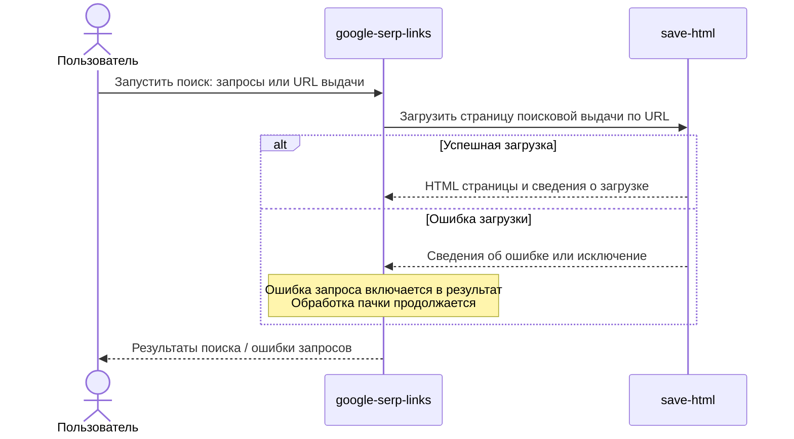

# Взаимодействие скриптов

Просмотр через общий компонент: [sequence.html](sequence.html).
Исходник: [sequence.mmd](sequence.mmd). Статическая версия: [sequence.svg](sequence.svg).

Из общей папки проекта запустите `node scripts/mermaid-view/server.mjs`, затем
откройте [диаграмму](http://127.0.0.1:4173/google-serp-links/docs/sequence.html).

Пользователь запускает `google-serp-links`, передав поисковые запросы или URL выдачи.
`google-serp-links` передаёт URL поисковой выдачи в `save-html` и получает HTML
страницы со сведениями о загрузке. Каждый скрипт представлен одним участником.
При неуспешной загрузке `save-html` возвращает сведения об ошибке или выбрасывает
исключение. `google-serp-links` фиксирует ошибку отдельного запроса и продолжает
обработку пачки. Если есть ошибки запросов, код завершения — `1`.
После обработки пользователь получает результаты поиска или ошибки запросов.

